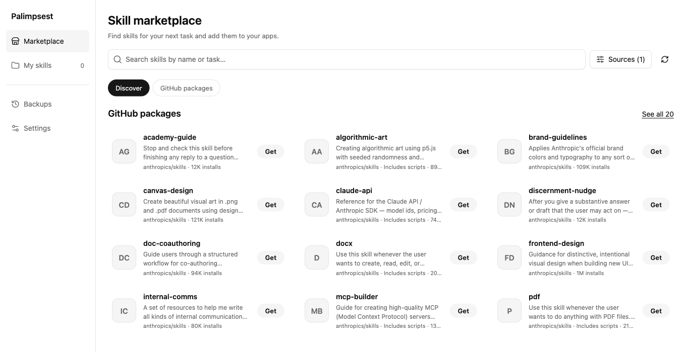
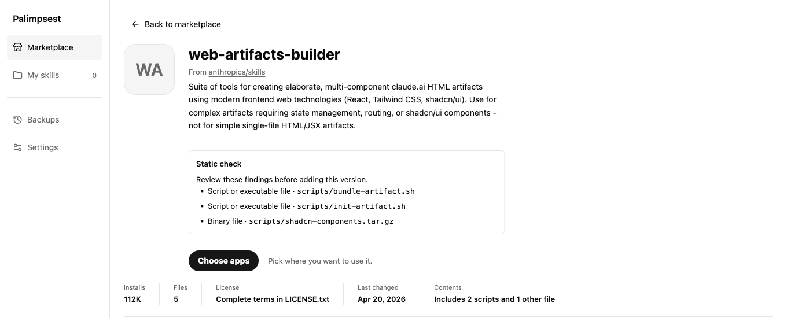
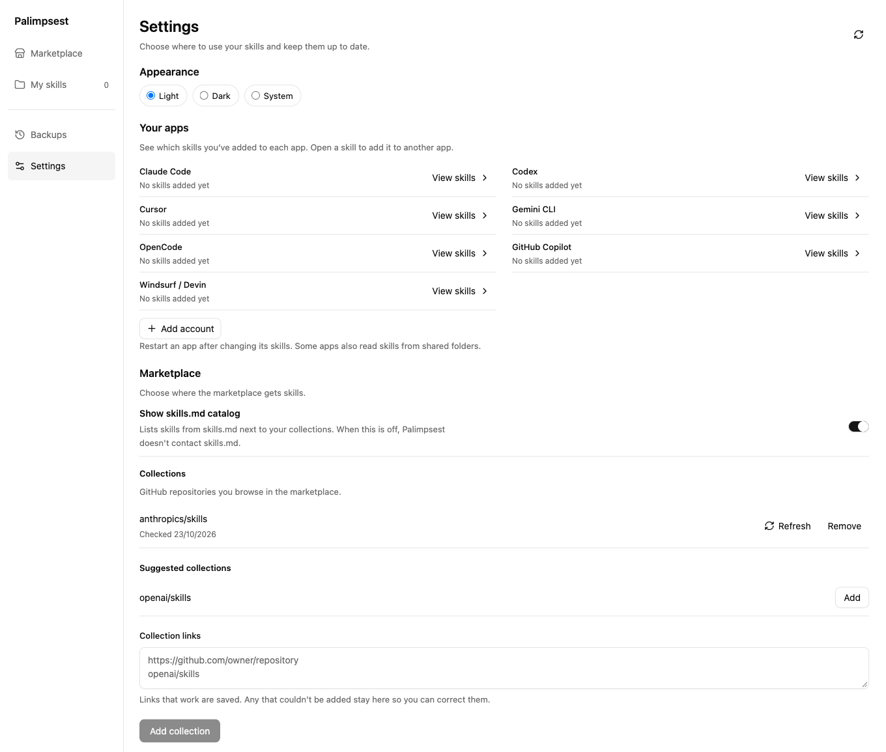

# Palimpsest

Palimpsest is one local skill library for people who use Claude Code, Codex, Cursor, Gemini CLI, OpenCode, GitHub Copilot, or Windsurf / Devin. Preview skills from public collections and skills.md, with scripts and hidden characters flagged for review before you add anything. Optionally follow a skill policy kept in a Git repository: allowed collections, pinned versions, and blocked skills, applied as one change you can undo.

This is an early project: review previews before applying changes and keep an independent backup of your skills.



Discover skills from public collections, with script indicators on package cards.



Read the static check findings and package facts before choosing where to add a skill.



Choose an appearance and manage the skills.md catalog and marketplace collections.

## What it does

- Opens into the marketplace, with search across skills.md and added GitHub collections. Hosted skills provide instruction previews; GitHub packages can be previewed and added to your local library. Skills added from a collection show an update when the collection has a newer version; Check for updates in My skills refreshes the collections, and each update shows its changes first and is saved in Backups.
- Detects harnesses from configuration folders, executable locations, macOS app bundles, and Copilot extensions. Locations shows the evidence; Refresh checks again.
- Finds personal skills in each supported harness's default skill folders, including `~/.agents/skills` and Devin's additional `~/.config/devin/skills` folder.
- Compares whole packages, including references and scripts, and flags differing versions.
- Shares packages through `~/.harnesses-shared/skills` and tool-specific symlinks.
- Edits skill files with operation backups and checks for changes made elsewhere.
- Browses public GitHub skill repositories and previews packages before installation.
- Flags scripts, binary files, hidden characters, download-and-run commands and credential paths in package and update previews. Findings point at what to read; they are not a safety verdict.
- Shows the repository, license, last change and contents of collection skills, suggests well-known collections, and records which repository and commit each added skill came from.
- Settings covers appearance (Light, Dark or System), marketplace collections and the skills.md catalog, and a shared skill policy (see [Skill policy](#skill-policy)).

Palimpsest does not execute skill scripts. A tool consuming an installed skill may execute them; inspect third-party instructions and files before enabling a package.

Use **Review setup** to ask an installed Codex or Claude Code CLI to inspect your personal skills and propose changes. Palimpsest passes the inventory to the CLI and displays its report; the existing harness handles authentication, models, and tool use. Codex runs with its read-only sandbox; Claude runs in planning mode with only file-reading tools and no MCP servers. The review excludes app-managed plugins, synced skills, and system skills. Skill paths and inspected content go to the agent's configured provider and may use paid tokens. Reports stay in the current browser session; copy a report before reloading.

## Install and run

Use Node.js 24, npm, and Git on macOS or Linux. Windows installation is not supported.

```sh
npx github:MBuelowius/palimpsest ui
```

npm downloads and builds Palimpsest from GitHub on the first run. `ui` starts a background server at <http://127.0.0.1:4319> and opens a browser on macOS. On Linux, open the printed URL yourself. Add `--no-open` to skip opening a browser. This uses your real home directory; sharing, editing, enabling, and installing skills can change its contents.

Stop the server with:

```sh
npx github:MBuelowius/palimpsest stop
```

Always include the GitHub repository in the command. The same-named npm registry package belongs to a different project.

### Try an isolated library

On macOS or Linux, start with an empty temporary home:

```sh
demo_home=$(mktemp -d)
npx github:MBuelowius/palimpsest ui --home "$demo_home"
```

Open the printed URL and create a skill. All library data for this server stays under the temporary directory. Stop it with `npx github:MBuelowius/palimpsest stop --home "$demo_home"`. Use a different `--port` if 4319 is occupied, passing the same port to `stop`.

### Install the local command

For a permanent `palimpsest` command, clone the repository and run the local installer. `npm ci` builds the app automatically:

```sh
git clone https://github.com/MBuelowius/palimpsest.git
cd palimpsest
npm ci
npm run install:local
export PATH="$HOME/.local/bin:$PATH"
palimpsest ui
```

Persist the PATH setting in your shell configuration if needed. The installer copies the build to `~/.local/share/skill-library/app` and writes `~/.local/bin/palimpsest`, tied to the Node executable used during installation. Reinstall after moving or replacing that Node executable. An existing app installation is retained as a timestamped backup. Stop the server with `palimpsest stop`.

## CLI

```sh
palimpsest --help
palimpsest harnesses
palimpsest list
palimpsest inspect example
palimpsest review --agent codex
palimpsest review --agent claude
palimpsest share example --source claude
palimpsest share example --source claude --apply
palimpsest history
```

`share`, `share-identical`, and `marketplace install` preview changes unless `--apply` is supplied. `enable`, `disable`, and `restore` apply immediately. Restoring is limited to the latest operation and refuses to overwrite later external edits.

Settings can add accounts: another config folder for the same app, such as `~/.claude-work`, which receives skills in its `skills` folder and shows up next to the app wherever you choose where to use a skill. Accounts are never selected by default, and removing one never deletes files.

Sharing, syncing, and marketplace installation default to the detected harnesses. Use `--tools cursor,gemini,opencode` to override detection, or choose harnesses manually in the UI. Configuration folders may remain after an uninstall, so detection is evidence of a local setup rather than a runtime health check. Harnesses can also discover skills in other apps' folders; Palimpsest manages the explicit links shown in its library.

Use `--home <existing-directory>` or `SKILL_LIBRARY_HOME` to select an isolated library. A different home detects only fixtures inside that directory, without scanning the host's PATH or system applications. State, backups, marketplace downloads, and server logs are stored under `<home>/.local/share/skill-library/state`. Local packages may contain private information; do not attach this state directory to a public issue.

## Skill policy

Connect a public GitHub repository containing `palimpsest-policy.yaml` at the root of its default branch:

```sh
palimpsest policy connect owner/repository
palimpsest policy apply                # Preview required installs and updates
palimpsest policy apply --apply        # Apply together; one restore undoes all changes
palimpsest policy show
palimpsest policy connect
palimpsest policy disconnect
```

Commands print JSON. Connecting again, or `connect` without a repository, refreshes the policy manually. Disconnect before choosing another repository. Downloads use the same hardened clone as collections, and nothing in the policy repository is executed. The parsed policy stays in `state/policy.json` and works offline. An invalid refresh keeps the previous policy. Disconnect leaves installed skills, collections and backups unchanged.

Apply downloads pinned snapshots to a local cache and previews changes, scan findings and skipped skills. It changes no skills without `--apply`. Applying creates one backup operation; `palimpsest restore <operation-id>` undoes every install and update together. Existing skills with another origin are skipped, and existing apps stay enabled or disabled. Nothing downloaded is executed. Snapshots are reused until disconnect.

The file must be a regular file, not a symlink, and at most 64 KB. The smallest policy is `version: 1`, which allows everything. All other settings are optional:

```yaml
version: 1
sources:
  github:
    - acme/agent-skills
  skillsMd: false
skills:
  - source: acme/agent-skills
    path: review/code-review
    commit: 9b1f0c2d3e4a5b6c7d8e9f0a1b2c3d4e5f6a7b8c
blocked:
  - web-scraper
```

`sources.github` lists allowed collections, compared without case sensitivity. Omit it to allow any GitHub collection; use `[]` to allow none. `sources.skillsMd` defaults to `true`. Each `skills` entry is required and pinned to a full 40-character lowercase commit hash. Its folder name is the last segment of `path`; paths must be relative and contain neither `..` nor backslashes. Names must be unique, valid library folder names and absent from `blocked`. Required sources must be allowed by `sources.github` when it is present. YAML aliases and duplicate keys are rejected.

Policy checks refuse disallowed collection downloads, blocked installs and updates, and installs or updates that differ from a pin's repository, path or commit. Blocked skills cannot be shared, synced or enabled in another app. Existing skills are never deleted or turned off automatically; `show` reports missing skills, versions that differ from pins, occupied names, blocked skills and disallowed sources. Local skill creation remains available.

Settings shows the connected policy and where this computer differs from it, and previews required skills before applying them. `palimpsest policy apply` does the same from the command line. When the policy sets `sources.skillsMd: false`, the skills.md catalog stays off whatever the Marketplace switch says.

Unknown settings are ignored and listed as warnings. Within `version: 1`, new keys may only add information. A key that restricts what the client may do must raise `version`, because older clients ignore unknown keys. Versions newer than this client supports are rejected.

## Development

```sh
npm ci
npm test
npm run build
```

For live development, run these in separate terminals with the same temporary home:

```sh
SKILL_LIBRARY_HOME=/path/to/existing/demo-home npm run dev:server
```

```sh
npm run dev
```

Open <http://127.0.0.1:4317>. Vite proxies API requests to the server on port 4318. `npm run format:check` checks formatting; `npm run format` applies it.

The React UI lives in `src/`; filesystem operations, HTTP routes, and the CLI live in `server/`. `scripts/build.mjs` bundles the CLI alongside the built web UI. Tests use disposable directories and Node's test runner.

## Contributing and support

Read [CONTRIBUTING.md](CONTRIBUTING.md) for the development and review process and [CODE_OF_CONDUCT.md](CODE_OF_CONDUCT.md) for community expectations. Use [GitHub issues](https://github.com/MBuelowius/palimpsest/issues) for reproducible bugs, feature proposals, and usage questions. See [SECURITY.md](SECURITY.md) for private vulnerability reporting.

## License

[MIT](LICENSE). Third-party dependencies and skill packages retain their own licenses. Palimpsest's license does not grant rights to downloaded skills.
